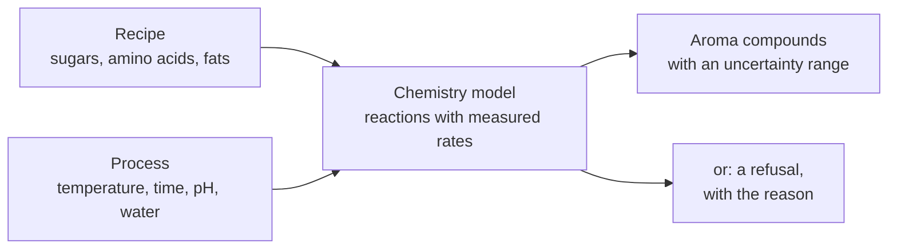
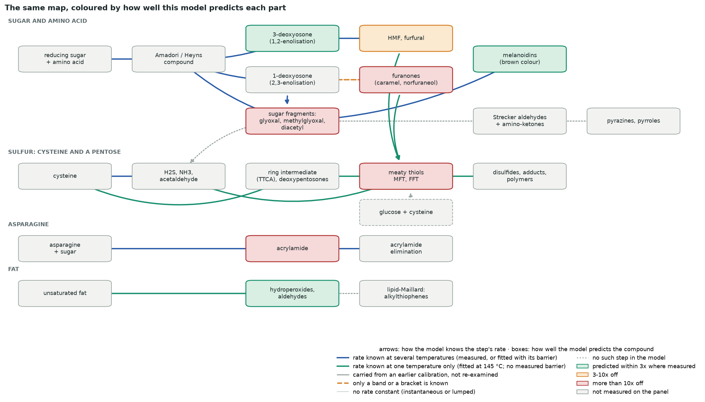

# Maillard

[](https://www.python.org/downloads/)
[](https://opensource.org/licenses/Apache-2.0)
[](results/validation/core_panel_scores.md)

**Maillard is an open attempt to predict how a cooked plant-based food will smell, from its recipe and
how it is cooked.** It is for alternative-protein scientists who want meat aroma without the animal.

When food is heated, sugars react with amino acids (the *Maillard reaction*) and fats break down. Together
they make the compounds we smell as "meaty", "roasted", "caramel" or "fatty". Change the sugar, the pH or
the cooking temperature and the aroma changes. The goal of this project is to say in advance *how* it will
change, so that fewer kitchen trials are needed.

## Where it stands, in one paragraph

**It cannot predict aroma reliably yet, and it says so.** Today it is useful for three narrower things:

1. **Telling you what the published research does and does not establish** about each recipe choice.
2. **Answering only what the evidence supports.** When it cannot answer a question, it says no and explains why, instead of printing a number.
3. **Telling you which experiment would teach it the most.**

The main obstacle is data, not ideas: very few published experiments were designed in a way that
answers the questions a food developer actually asks.

## What we have learned

- **Published research answers few of the practical questions.** We read 99 studies (2,581 comparisons
  from 44 laboratories). They settle only **8 of 75** "if I change X, what happens to aroma Y?" questions. For example:
  - leaving out cysteine cuts the main meaty compound (2-methyl-3-furanthiol) about sixfold;
  - xylose gives about three times the potato-like methional of glucose;
  - a higher pH (6 to 7.5) gives less of the coffee-like 2-furfurylthiol and more of the nutty, roasted pyrazines.

  None of these studies used a pea or soy protein isolate ([the map of what is known](results/validation/experiment_map.md)).
- **Laboratories disagree by about tenfold** on how much of the key meaty compounds a recipe makes.
  That is often more than the effect of the recipe change itself. Until we know why, absolute amounts cannot be predicted.
- **The model's chemistry for meaty aroma is not yet good enough.** On data it has never seen, its
  predicted differences between two recipes are worse than simply predicting "no change", and its response to pH is wrong in structure. Every miss is published, not hidden.
- **Literature collected with AI tools must be checked by hand.** An audit of this project's own first
  data set found 61 % of its key citations defective. Everything the model uses today has been checked against
  the original paper ([the audit](docs/history/AUDIT_legacy_lane_2026-08.md)).

## What would move it forward

New experiments, designed to answer the questions directly. The one we most want run first:

> **A small study in pea protein (44 vials, one laboratory).** It would vary the sugar (ribose or glucose),
> the sulfur source (cysteine or thiamine) and the pH (6 or 7). It would be the first data on the choices every plant-based formulation
> makes first. [One-page brief](docs/guides/P3_STUDY_BRIEF.md) · [full design](docs/guides/FACTORIAL_LEVER_STUDY.md).

The full ranked list, with what to record so results from different laboratories can be combined,
is one page: [EXPERIMENTS_BRIEF.md](docs/guides/EXPERIMENTS_BRIEF.md). **If you have data already, we would
love to compare it**: the tool scores the model against your measurements without changing anything.

## How it works



The model is a network of chemical reactions. Each reaction's speed is either measured in a
published paper, fitted under a rule written down before the fit, or a stated assumption with its
uncertainty. No number is invented, and none is computed from quantum chemistry. The model's
strongest output is a **comparison** ("recipe A gives about 3× more of this compound than recipe B"), because
much of the error cancels in a ratio. Absolute amounts are much less reliable.

## How good is it?

| question | today |
| --- | --- |
| Amounts within 3× of a published measurement it has never seen | **10 of 23** |
| Direction of an effect ("more or less?") against published claims | **10 of 19**, no better than a coin |
| Meaty-compound amounts for a new laboratory | refused: laboratories differ too much |
| Which experiment to run next | its most trustworthy output |

The full scorecard, with every caveat, the generated model card and how the numbers have moved over
time, is in the [technical overview](docs/reference/TECHNICAL_OVERVIEW.md#how-well-calibrated-is-it).

## Try it

```bash
git clone https://github.com/PabloAMC/Maillard.git
cd Maillard
./scripts/docker_maillard.sh bootstrap        # sets up the Python environment (needs conda)
```

```bash
python scripts/maillard.py compare --template > my_comparison.yml   # write two recipes, A and B
python scripts/maillard.py compare my_comparison.yml --report compare.html
python scripts/maillard.py explain 2-methyl-3-furanthiol             # where a compound comes from
python scripts/maillard.py wishlist                                  # what to measure next
python scripts/maillard.py ui                                        # the same in a browser page
```

Every command, and when each one refuses, is in the [quick start](docs/guides/QUICKSTART.md). Three worked
examples are in the [tutorial](docs/USING_THE_TOOL.md).

## Where to go next

| If you want to… | Read |
| --- | --- |
| understand the chemistry and the model, with no background | [Introduction](docs/guides/INTRODUCTION.md) (eight short sections, each with a figure) |
| run an experiment that helps | [Experiments brief](docs/guides/EXPERIMENTS_BRIEF.md) · [pea-protein study](docs/guides/P3_STUDY_BRIEF.md) |
| use the tool | [Quick start](docs/guides/QUICKSTART.md) · [Tutorial](docs/USING_THE_TOOL.md) · [Glossary](docs/guides/GLOSSARY.md) |
| check the numbers | [Technical overview](docs/reference/TECHNICAL_OVERVIEW.md) · [Validation contract](docs/reference/VALIDATION_CONTRACT.md) · [every paper used](docs/guides/SOURCES.md) |
| change the code | [CONTRIBUTING.md](CONTRIBUTING.md) |

[](docs/guides/INTRODUCTION.md)

## Citation

If you use Maillard in your research, please cite (machine-readable: [CITATION.cff](CITATION.cff)):

```
Moreno Casares, P. A. (2026). Maillard: a kinetic model of the Maillard reaction for
alternative-protein flavour work. GitHub repository. https://github.com/PabloAMC/Maillard
```

## License

[Apache 2.0](LICENSE)
