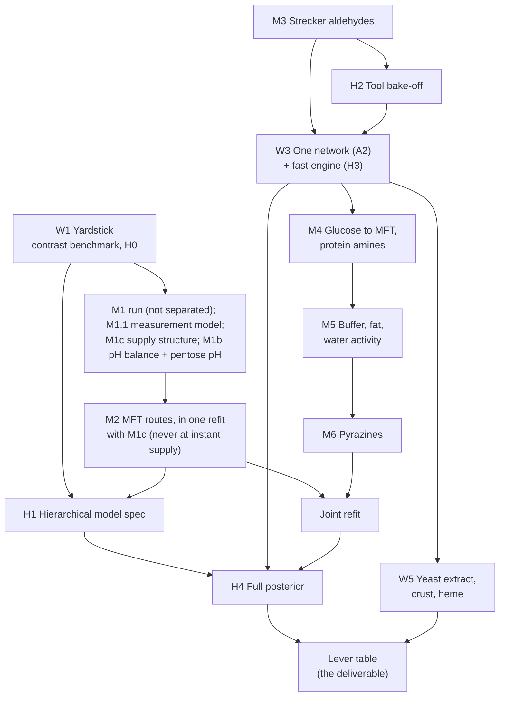

# Status and plan

*The one plan for this repository. Rewritten 2026-11-02 for readability; the content is the 2026-11-01 plan as
refined on 2026-11-02. The previous text is kept verbatim in
[docs/history/STATUS_AND_PLAN_2026-11-01.md](../history/STATUS_AND_PLAN_2026-11-01.md). Older records that cite
"STATUS_AND_PLAN sec. 5", "rule (a)", "B0", "roadmap row 2" or "triage item 3" refer to that file.*

**Contents.**
1. Who this is for and what they need
2. Where the model stands
3. Why it fails: five root problems
4. The plan at a glance
5. The workstreams
6. Timeline: what runs in parallel
7. How a change ships
8. Checkpoints and odds
9. Not in the plan
10. Glossary of codes

---

## 1. Who this is for and what they need

The users are alternative-protein scientists who formulate meaty flavour on pea, soy or similar proteins. They ask
questions like these:

- "If I add 0.5 % yeast extract, or swap ribose for glucose, does the meaty note go up or down, and by how much?"
- "What does raising the pH, adding fat, or cooking longer do to the meaty, roasted and off-notes?"
- "Which change is worth testing in the lab first?"

So the tool must:

1. **Get the direction and rough size of each lever right** for the key odorants. The odorants are the meaty thiols
   (MFT, FFT, H2S), Strecker aldehydes, pyrazines and lipid aldehydes.
2. **Accept real recipes and real cooking.** Ingredients such as protein isolate, yeast extract and oil. Cooking such
   as a pan-fried patty, not only a sealed vial of buffer.
3. **Say honestly how sure it is,** for a laboratory it has never seen.
4. **Improve on a lab's own data** (the `calibrate` verb, which exists).

Absolute levels that hold across laboratories within 3x are NOT a near-term goal. Laboratories disagree by 10x to
1000x on the same pot; no model removes that without designed data.

**Owner decisions, 2026-11-02.** Work continues without new laboratory data; the designed-experiment brief is paused.
The plan's priority is mechanisms that make the model better, not more process.

## 2. Where the model stands

Shipped calibration B60. Numbers from `results/validation/core_panel_scores.md`, `contrast_scores.md` and EX-056.

| question | today |
|---|---|
| absolute level within 3x, out of sample | 14 / 56 rows (median miss 11.8x); the "typical yield" baseline does better (15 rows, 8.1x) |
| ratio between two pots of one study | median error 0.31 dex against 0.28 for "no change"; direction right 12 / 25 |
| meaty sulfur odorants | 10 / 40 rows within 3x; thiol leave-one-lab-out NOT ADEQUATE (90 % intervals cover 0.34) |
| acrylamide, lipid aldehydes | the null model wins |
| pyrazines | about 3 orders of magnitude too low |
| Strecker aldehydes, methional, 2-acetyl-1-pyrroline | absent or refused |
| a real recipe with both sulfur and acrylamide chemistry | refused (the lanes do not combine) |

What works today: the experiment ranking (`rank`), per-lab calibration (`calibrate`), honest refusals, and an
evidence base of about 1,800 two-reader-verified fit rows, a 32-family pathway atlas and 20 ranked engine errors
([ENGINE_VS_LITERATURE.md](../reference/pathway_atlas/ENGINE_VS_LITERATURE.md)).

## 3. Why it fails: five root problems

Every task in this plan exists to fix one of these.

| # | root problem | example | fixed by |
|---|---|---|---|
| R1 | **Wrong mechanisms in the meaty sulfur chemistry** | the model destroys thiols far faster than any pot; MFT runs 99.9 % through a route labelling puts at ~7 % | workstream W2, steps M1, M2 |
| R2 | **Missing chemistry** | no Strecker aldehydes; glucose makes almost no MFT; pyrazines far too low (a dicarbonyl-supply and amine-identity deficit, not a sink: M6 case) | W2, steps M3, M4 (supply and amine classes), M6 (the sinks) |
| R3 | **Lab pots do not transfer to food** | constants measured in phosphate buffer at fixed pH; foods are unbuffered, fatty, drier, with protein as the main amine | W2 steps M1b (the pH balance and the pentose-side pH laws), M4, M5; W5 |
| R4 | **The software cannot represent a whole recipe, and fits are slow** | four separate lanes that do not combine; one fit evaluation takes 2.5 - 21 s | W3 |
| R5 | **Uncertainty is not honest for a new laboratory** | fitted constants absorb laboratory offsets; out-of-sample coverage 0.34 | W1 (H0), W4 |

## 4. The plan at a glance

Six workstreams. W1 measures progress. W2 is the core: it fixes the chemistry. W3 and W4 give the engine and its
uncertainty. W5 turns the engine into a tool for a formulator. W6 is the owner's outside-data requests.

Read it as three lines of work that meet at the end:
- **the chemistry line** (M1 - M6, then one joint refit);
- **the engine and uncertainty line** (one network, fast engine, hierarchical posterior);
- **the product line** (ingredients, cooking, the lever table).

## 5. The workstreams

### W1. Yardstick: know whether a change helps

| task | what | state | effort |
|---|---|---|---|
| W1.1 | **Contrast benchmark scorer** on the frozen split v2: does the engine get within-study contrasts (pH, time, cysteine +/-, phosphate) right, against two null models | **done** (PR #48, 2026-11-03): prereg v6 frozen, scored once (`results/validation/kinetic_core_contrast_benchmark_score_v1.md`). Direction not distinguishable from a coin (weighted S 0.43, 90 % 0.19 - 0.77); log-ratio error not distinguishable from predicting no change (median 0.66 vs 0.41 dex). PROVISIONAL (3 labs) | -- |
| W1.2 | **H0: between-laboratory error out of sample** from the thiol leave-one-lab-out (EX-056). Sets how wide intervals must be for a new lab | pre-registration v3 frozen (`kinetic_core_between_lab_tau_h0_prereg.md`) | 4 - 6 h + ~1 h compute |
| W1.3 | **Profile one fit evaluation** (Jacobian, pH solve, integrator) before the next long refit | not started | 2 h |

**What the benchmark can and cannot judge (2026-11-04).** W1.1 answers 4 of the 65 held-out cells; the rest are
refused (an operation the engine lacks 23, inputs missing 17, a species it does not model 12, a precursor it cannot map
7, other 2). On what it does answer, it would detect a 70 % per-step agreement in direction only 43 % of the time (its detection
curve). So it cannot show on its own that a W2 step helped:
- **A step's verdict rests on its own decisive data** (sec. 7, item 4), never on the benchmark score.
- **The benchmark is the side-effect record** (sec. 7, item 7): every held-out row, before and after each shipped step.
- **The January re-score is descriptive.** It reports coverage first, then the direction and log-ratio scores on the items
  answerable both times. It is read as evidence about the plan as a whole only where coverage has grown, for instance
  the Strecker and methional items after M3 (today the engine predicts no change on all 20 methionine items) or the yeast-extract
  pots after W5.1.

### W2. Chemistry: fix the mechanisms (the core)

Ordered by expected gain for plant-based odorants. Each step names its evidence and its decisive data; how a step ships is sec. 7. "E" numbers
refer to the ranked errors in ENGINE_VS_LITERATURE sec. 3 (and its amendments in secs. 5 and 7).

| step | mechanism | what to build | evidence | decisive data (sec. 7, item 4) | effort |
|---|---|---|---|---|---|
| **M1** | **Thiol supply and loss, judged as combinations** (E10, E12; rescoped 2026-11-04 from its [case](../reference/cases/M1_thiol_loss_oxidant_ph_drift.md) and CF-107) | **M1 run (EX-061, 2026-11-05): NOT SEPARATED** under the frozen rule, but artefact-driven (a linearised floor sensitivity; evaluated exactly the reservoir favours C1). The data: a reservoir is real (the incumbent loses ~99 % of cysteine and pentose within 5 min at 120 C), C1's is 3 - 5x too slow and loses the FFT shape; before M2 fix the measurement model (no between-lab tau on C/C0 series, floors from the assay, exact densities) and free the reservoir's release rate ([review](../../results/validation/kinetic_core_m1_results_review.md)). **Then (2026-11-05) the supply screen** (`kinetic_core_supply_structure_signature_screen.md`; plug-in runs, no fits): no supply structure (C1; a pH-dependent exchange, whose slope Cao's drift bounds at m <= 0.18; a flat K plus a 1:1 drain) reproduces Zhai 2021 Fig. 4b (TTCA lost ~10x faster at pH 7 - 8 than at 5.5) or Zhang 2025b's mass balance (~19 mM of each reactant in no measured pool); a base-favoured TTCA exit passes the first, nothing inside non-Zhang bands the second. Supply moves to **M1c**; no Cys / Xyl label swap in Zhang 2025b (checked on the PDF). **M1.0 done (EX-060, 2026-11-04):** G1 holds at B60, more strongly than at B9 (at most 0.009 % of the oxidant used; phi = 1 adds at most 0.08 %), so no oxidant source enters M1. In Cao 2017 free cysteine and xylose fall within 30 min to a plateau (free Cys 0.06 - 0.08 of 0.4 mol/L, 15 - 20 % of the charge; corrected 2026-11-05) but the TTCA / cysteine-Amadori reservoir still holds about all of both after 5 h (1.06 / 1.09 of the charge), where R0 has no reservoir and burns the pentose in 1.8 s: the measured intermediates require C1. On Schieberle 2000, R0's MFT 360 / 30 and 720 / 30 ratios miss by -1.09 and -1.42 dex (peak at 2.6 h). **M1.0 as planned:** does B27's gate G1 still hold at B60 (the dimer step uses < 1 % of the oxidant, so no oxidant SOURCE can move the disulfide share; P ~0.85 it holds); the engine at B60 on the decisive data below. Then three combinations, each with `k_ttca_cys` in the structure (Cao 2017's K, not frozen) and the frozen pot-independent sink `k_mft_decay` freed or banded: **C1** slow cysteine-Amadori / TTCA supply (B59b); **C2** C1 + a loss that free cysteine slows (EX-050's form); **C3** C2 + the disulfide side: Guth's release declared, not fitted, and the deoxypentosones as an oxidant POOL with a declared pH law (not B27's source). Out, with reasons: B17a (Stack's measured K(T) makes it inert at process temperature); B27 as built (G1 arithmetic); B11's O2 (no within-study O2 arm at process temperature; Xu 2010 at 140 C finds air vs N2 changes neither thiol nor disulfide) | CF-107: four refused sink waves (B16, B17b, B17a, B25) are one fit optimum in a degenerate state, 77 % of its cost from TTCA rows on the frozen `k_ttca_cys`, best starts unconverged; against instant supply and a frozen fast sink, every added sink structure was switched off. Whole-model refusals are therefore not evidence against C1 - C3. B16 with its barrier ceiling lifted (converged) still turns MFT over at 6 h: the 100 C rise is a supply problem. Guth 1995 measures disulfide release far faster than B17b's fitted floor | Schieberle 2000's own ratios (MFT 360 / 30 and 720 / 360 min; measured still rising) separate the incumbent from C1 - C3; free cysteine and sugar over time (Cao 2017, Zhang 2025b, Zhai 2019) separate C1 from C2; the disulfide share's pH slope inside Zhou 2023, Zhang 2024's cystine vs cysteine arms and Whitfield 1999's fed pots judge C3 | M1.0 ~3 - 4 h; C1 - C3 2 - 3 days |
| **M1.1** | **Measurement model and fit driver, before any thiol refit** (new 2026-11-05, from M1's review and the premortem of the re-sequence) | No between-lab tau on C/C0 or ratio series (tau on absolute levels only); floors from each assay's reported LOD / LOQ, never a data point (only Zhai 2021 prints one: elsewhere a declared transfer, run as a sensitivity); H0's within-lab omega (0.419 dex: the worse of H0's two sets governs, prereg sec. 3.6 / D2 and A1 item 3; the reset set gives 0.390) in every unit's primary covariance; exact or Monte-Carlo densities on every form that can flip a sign (PSIS k-hat < 0.7, ESS >= 100); a unit favours or vetoes only where the favoured rival is adequate (posterior-predictive p > 0.05) or the means differ by more than omega, else "both inadequate"; Holm across guard groups; unidentified coordinates integrated over their band; central-difference polish (the forward-difference Jacobian is up to 7 % off, bake-off); asserted convergence. The Cao 2017 pot-input audit is done (2026-11-05): the keying is correct (free-base cysteine, Na phosphate set before mixing, 25 C label); a reported 0.8-unit gap compared the engine's in-situ (90 C) pH with Cao's cooled readings. On the cooled scale the engine starts at 5.50 like Cao and, under C1, reads ~0.2 low at 30 min, all of it 7.9 mM of cysteine carboxyl with its amine declared destroyed (CF-084 explanation 1); Cao stays a descriptive cross-check, not a control. Every pH comparison states its scale (cooled or in situ) | M1's results review (three MAJOR findings); the M2 draft's adversarial review (BLOCKER 1); the JAX bake-off's gradient check | -- (infrastructure: tested against M1's records, which it must reproduce under the old settings) | 8 - 12 h |
| **M1c** | **Thiol supply structure** (new 2026-11-05, from the supply screen) | A base-favoured TTCA exit, plus an account of Zhang 2025b's ~19 mM pool (open-chain or Schiff-base TTCA, cystine, the cysteine Amadori compound onward). Pool members enter only with a measured or same-class constant or a declared band, never a free pool sized to the gap (that would be CF-107 again). Items 1 - 5 frozen before any newly found paper is read: the screen's pots (Cao 2017, Zhai 2021, Zhang 2025b) are declared seen, so the decisive data must be others, or the verdict is development-grade and the decider is designed data (W6). Screened first on four signatures: (a) Cao's flat K under drift, (b) Zhai's pH series, (c) Zhang's mass balance, (d) the FFT shape (Schieberle; B60's FFT rows; C1 lost it). Runs at the measured pH trajectory where one exists, whatever M1b(i) finds. **Stop rule:** if no structure passes (a), (b) and (d) within ~25 h, supply is "not identifiable on disk": the R0 / C1 envelope stays under H0's relative-only ruling, and the designed-data request goes out | The screen record; Cao 2017 (K, pool closure, drift); Zhai 2021 Fig. 4b; Zhang 2025b (development data now: its blank pot was seen under the engine on 2026-11-05); M1's review; the literature search of 2026-11-05 (ring-chain pH law; norfuraneol decay at pH 5 - 6.5; the missing pool; assay LODs) | To be named in the case before the search's papers are read; P ~0.6 that nothing unseen and decisive exists on disk | case 3 - 4 h; build + screen 10 - 18 h; fit 4 - 6 h + 6 - 12 h compute |
| **M1b** | **pH: the pot's balance (CF-084) and the pentose-side steps** (E16, E2; rescoped 2026-11-04 from its [case](../reference/cases/M1b_sugar_step_ph_sulfur_lane.md)) | **Re-sequenced 2026-11-05:** part (i) runs first and on its own, timeboxed at ~14 h, judged on CF-084's own controls (Meynier, Hou, Zhou; Cao's trajectory is NOT a control, since TTCA and the cysteine Amadori compound are titratable and their budget is M1c's question); it does not gate M1c; its stop rule: if neither rival passes both controls, "balance not identified" and the measured-trajectory operator stays; shipping it moves pH everywhere, so the owner signs off first. Part (ii)'s chosen rival enters the joint refit (its norfuraneol decay and 3-deoxypentosone removal move M2's decisive pot-D share), or is declared deferred with that effect stated. (i) The charge-balance pH scores pots only once its two controls pass, with CF-084's two rivals built and compared: the released ammonia survives (less acid), or the acid forms after the Amadori product is gone. (ii) pH laws on the pentose-side steps for the rival the data need: base-catalysed norfuraneol decay (E16; B61's prereg, its fit stopped and owed on B64), the enolisation split carried to pentoses (E2), a pH-dependent pentose + amine entry, or a base-favoured 3-deoxypentosone removal (EX-045, EX-046). Not built: `ph.trunk_terms` on its own, which slopes only the three hexose Amadori steps and is inert in pentose pots; E2's hexose part waits with E2 | The shipped engine's norfuraneol and furfural are pH-free in glycine-pentose pots (identical to 14 digits on Meynier's ladder; the pentose + amine entry is off, the amine-free pentose steps and the norfuraneol decay carry no pH). CF-084: the balance fails both controls. EX-001 - EX-003: Martins' slopes on the acids (acetic transferred, formic did not) | Fed norfuraneol loss vs pH (Mikami 2017 at pH 8, 100 C; Nakamura 2020) for E16; the 3- / 1-deoxypentosone ratio vs pH inside Zhai 2021 and Hou 2026 (the engine has the wrong sign, EX-033); acetic acid vs pH (Davidek 2006a, 2008); the pH controls (Meynier's drift <= 0.2, Hou's trajectory). Meynier's norfuraneol ladder stays held-out (item 7 only). The split and the removal rivals cannot be separated without an in-situ pentose trap across pH (W6) | 2 - 3 days |
| **M2** | **MFT route shares** (E6 + E11), in ONE refit with M1c's supply structure and M1b(ii)'s chosen rival | Per-route barriers bounded by measured classes, fitted together with the supply structure the data favour (the steps share rows, and their errors stack). **Never at instant supply** (half of CF-107's compensator; the drafted design put P(anything ships) at ~0.1 there). The route design is drafted and parked (`kinetic_core_m1m2_supply_routes_refit_prereg.md`, v2: it supersedes the 2026-11-01 route prereg, moves Cerny 2007's 145 C labelled shares in-sample, holds the furfural barriers at the shipped values in every rival, and needs a synthetic power check before it freezes: under omega the shipped engine misses pot D by 6.9 sd but Hofmann by only 0.6 sd) | labelling in one laboratory (Cerny, Nestlé); fed-intermediate comparisons in two (de Roos 2005 / Laarhoven at Givaudan, reported only: `simulable: false`; Hofmann) (corrected 2026-11-05) | Cerny pot D norfuraneol share (measured 0.07, engine 0.98) and MP3P share; Hofmann 145 C fed pots; Zhai 2021's fed-TTCA 140 C MFT time-course shapes (E11; shared 120 C denominators with B60 declared) | 2 days + ~1 day on >= 8 cores |
| **M3** | **Strecker aldehydes** (E3; rescoped 2026-11-04 from its [case](../reference/cases/M3_strecker_aldehydes.md)) | First the prereg EX-051 asked for and that does not yet exist: one ARP-Phe decay shared by the fed-ARP and glucose pots, and two routes (dicarbonyl + amino acid; the Amadori product oxidised directly). Rivals: the current engine (it refuses); the claim; the dicarbonyl route only, with unmeasured or O2-made osones; both routes with a pot-specific decay (EX-049's optima); the claim with the decay moving with pH, buffer and order. Then feed the layer from the network; that phase shares the pyrazine steps (`r_go_ak`, `r_mgo_ak`), so it moves shipped pyrazines: owner first | Fed intermediates: Hofmann 2000b, Weenen 2001, Deng 2022 (the only second laboratory); measured ARP decay (Martins 2003, Deng 2021). The whole-model refusals (B22, B22b, B24, B29) are weak evidence: compensating errors named in the case. Cremer (v1 TEST) and Balagiannis (v2 TEST) carry no route marker and no donor: item 7 only | The fed ARP's early aldehyde shape (no lag if the Amadori route runs, a lag if only dicarbonyls do); fed vs in-pot ARP decay (no amino-acid ARP decay measured at 100 C reaches EX-049's 0.058 - 0.069 /min); the fed ARP's O2 mass balance (the dicarbonyl-only rival needs >= ~0.5 - 0.7 mol free osone per mol ARP; needs Hofmann 2000b Figs. 2 - 3 keyed); PA / PAA ratios. The TUM Becker contrast (F16#14, TEST in v1 and v2) measures no donor or ARP, sits at pH 5.2 outside the layer's scope, and is read only in item 7. The dicarbonyl-only and two-route rivals rest on one laboratory (DFA) | prereg 3 - 4 h; keying Hofmann 2000b Figs. 2 - 3 2 - 3 h; layer 2 - 3 days |
| **M4** | **Glucose to MFT; amine classes** (E1, E8; rescoped 2026-11-04 from its [case](../reference/cases/M4_glucose_mft_protein_amine.md)) | On the one network (W3): glucose + cysteine -> the cysteine-glucose Amadori compound -> 1-deoxyglucosone with cysteine released -> the shared pentose MFT steps (part G); amine classes as species (free amino acid, cysteine, peptide, protein lysine) with their competition declared (part A). Rivals: the incumbent; the claim; a route that bypasses norfuraneol; C2 + C3 recombination; the hexose -> C5 entry switched on alone. The amine-catalysed enolisation (E8) waits: switching on M1's cysteine-Amadori route already retires the steps it would act on, and its development evidence at process temperature is too thin to fit | Hofmann Table 5 (one lab, 145 C): norfuraneol / MFT 7.1 in the glucose pot vs 2754 for ribose; glucose MFT vs pH peaks at pH 5, the opposite of ribose; labelling rejects C2 + C3 recombination by a measured share; de Roos: the Cys-glucose Amadori compound forms yet gives < 0.05 mg MFT per mol Cys at ~100 C. The B8 - B51.1 fits are whole-model, weak evidence; the red-team probe of the hexose entry inherits E6 / E11 | Within-pot shapes that cancel scale: glucose's MFT / norfuraneol ratio against ribose's (390x its norfuraneol ratio; separates the claim from the bypass), and the pH profile of glucose MFT. The plan's earlier ribose / glucose end-point ratios (10.4, 4.3) are moved by E6, E11 and the H2S budget too and the ribose arm is a B60 fit row: side evidence. No fed hexose intermediate to MFT or positional glucose label exists | 1 week (after W3) |
| **M5** | **Buffer, fat, water activity** (E5, E7; rescoped 2026-11-04 from its [case](../reference/cases/M5_buffer_fat_water_activity.md)) | Buffer: a per-step phosphate factor, linear with an intercept, against no factor / saturating / pH-only / step-specific rivals (B53 never ran; the form in EX-058 rested on TEST sources, so it is not settled). Fat: the thiols' loss to lipid, as partition (the plan's earlier claim) against lipid-electrophile capture of MFT (CF-031) and both. Water activity: B54's design (whole-phase concentration basis, Tg gate) against the shipped table, concentration only and step-specific | Davidek's pH-stat (x2.8 - 3.6 at held pH) rejects the pH-only rival; Bell's 0.5 vs 0.2 M ratio (1.74) rejects saturation with K <= 0.1 M; Mottram 2002: MFT x2.2 - 2.6 with FFT unchanged. The lipid fall is MFT-selective (x13 in Elmore; x9 to x2.2 in Yiltirak with fresh oil), which partition alone barely produces: the data favour capture | Buffer: dose ladders at held pH (Bell, Zyzak, Guan); fat: the MFT / FFT selectivity of the lipid fall (scale-free) and Zhang 2022's phase-resolved pot; water: Hofmann dry vs wet (ribose FFT x8, glucose x0.5). Potman and Kallen (v2 E5 TEST), Kim 1996, Zamora 2015, Hidalgo 1993 (v2 E7 TEST) and Xu 2011 (E12 TEST): item 7 only. No measured oil-water partition coefficient for MFT or FFT, and no MFT water-activity series beyond Modi 2008's peak areas | 1 week |
| **M6** | **Pyrazines: the sinks, and where the deficit really is** (E13, E14, CF-095; rescoped 2026-11-04 from its [case](../reference/cases/M6_pyrazines.md)) | A pH-flat dicarbonyl + amino-acid adduct sink; a finite aminoketone condensation with a measured-class constant; aminoacetone + MGO -> pyrrole as a competing sink. Rivals: the incumbent; the claim; the adduct sink only; a ring that never passes through free aminoketone; the deficit is supply and amine identity. Both sink structures LOWER pyrazines, while B18 T3 / T4 put the 2.9-dex deficit on the trunk's dicarbonyl supply in water and on glycine standing for lysine: the deficit is M4 / W3 supply and amine classes, not M6 | Piloty: 82 - 86 % amino-acid consumption vs 1 - 12 % Strecker products; Zhou 2024's zero-order rise from t = 0, where the 5-aminolevulinic-acid analogue implies a ~115 h lag (a lag < 30 min needs a constant ~5e4x the analogue): the measured analogue rejects the finite condensation as built, unless the ring bypasses free aminoketone. No aminoketone has ever been measured in a pot | Zhou 2024's early time course; Adams' pyrrole and DMP against MGO excess and pH; Piloty across designs; EX-021's 2.3-dex gap shared with M3. Leahy's pH ratios are B18 calibration inputs and the four E13 TEST studies measure the mixing ratio, not the sinks: item 7 only (their scores are still owed) | 3 - 4 days |
| **JR** | **Joint refit** | One refit after M1 - M6, not one per step | -- | all of the above, together | ~1 day + compute |

**Already decided, not in the steps:** E4 (pyrazine pH law) is a declared band, no change (owner, 2026-11-01). CF-077
(methylpyrazine cross-pair factor) is merged (PR #37).

**Waiting for evidence:** E15, E17 - E20, and E2's hexose part (E2 and E16 enter W2 as rivals inside M1b, 2026-11-04). Each enters W2 when a labelling, fed-intermediate,
trapping or within-study result discriminates its rivals, for instance from a W6 author reply.

### W3. Engine: one network, built to be fast

| task | what | state | effort |
|---|---|---|---|
| A3 | One explicit configuration object instead of global switches | **done** (PRs #34, #36) | -- |
| **A2 + H3** | **One composable network** (each chemistry module adds its species, reactions, rate laws and pH terms; one integrator) **written so it compiles with exact gradients** in **JAX + diffrax** (chosen 2026-11-05 by the sulfur-lane bake-off, [jax_bakeoff_sulfur_lane.md](../../results/validation/jax_bakeoff_sulfur_lane.md): rates to 1e-12 and trajectories to ~5e-6 dex of the engine, four stiff corners pass; the exact Jacobian 2.5x faster than the fits' finite-difference one at equal tolerance, 6.6x at rtol 1e-6; one forward solve 2.5x slower, ~75 % of it the pH root-find; the fits' forward-difference Jacobian is up to 7 % off its own central difference). The lanes become modules of one recipe. Agreement with today's lanes pinned by tests: rates to 1e-12 relative, trajectories to 1e-6 dex (bit-identical cannot hold across integrators). Forward mode for fits of ~20 parameters; fits at rtol 1e-6 once a check shows panel residuals move < 1e-3 dex; one focused step on the pH root-find. CasADi only if H4 moves off HMC. Then the chemistry of M4 moves onto it | contract in [A2_MODULE_CONTRACT.md](A2_MODULE_CONTRACT.md); its requirements include each case's "needs from the network" (`docs/reference/cases/` M1 - M6: cysteine-hexose Amadori and 1-DG species, amine classes as species with declared competition, an oil phase with phase-tagged observables, buffer and water-activity hooks, aminoketone / pyrrole / adduct pools, isotopologue pools, the forced-input driver); H3 was planned after A2, now merged into it so the engine is rewritten once | 75 - 115 h (bake-off estimate: module contract 20 - 30, lanes and switches 30 - 45, thermal and pH-stat modes 6 - 10, fit driver 10 - 15, pH step 8 - 15) |

Why together: A2 rewrites the lanes anyway. Writing them once in a form with exact gradients makes every later refit
faster (the bake-off measured 2.5 - 6.6x on the Jacobian, which is ~90 % of fit time per the W1.3 profile) and makes the posterior (W4) affordable. Starts when M3's Strecker layer needs the shared trunk: M1 / M2 still reshape the sulfur and trunk lanes, and a port started earlier would chase them.

### W4. Uncertainty: the hierarchical Bayesian fit

This was "inference track H". It gives intervals that hold for a NEW laboratory. It does not fix a wrong structure
(P ~0.15 that it alone makes the thiol lane beat the nulls), and it can hide one inside laboratory offsets, so it
runs after the chemistry steps it depends on, with tests that catch that.

| task | what | depends on | effort |
|---|---|---|---|
| H0 | between-lab error out of sample (listed under W1.2) | -- | -- |
| **H1** | **Specify the hierarchical model,** pre-registered: laboratory offsets on observation levels and on reported conditions (heat-up lag, pH drift, buffer); on a rate constant only where >= 3 labs inform it. Masking tests: (a) lab offsets regressed on recorded pH, T, buffer, method -- a trend names a missing mechanism; (b) offsets must not change within-lab signature verdicts; (c) an offset > 0.3 dex on a physical constant is a structural error | H0, M2 | 4 - 6 h |
| **H2** | **Tool bake-off.** The engine half was pulled forward and done on the sulfur lane (2026-11-05, see A2 + H3: JAX + diffrax chosen). Left for the Strecker layer: NumPyro; simulation-based calibration; a deliberately wrong structure must be caught; GPU benchmarked here before any Colab run | M3 | 5 - 8 h |
| H3 | the fast engine: merged into W3 (A2 + H3) | -- | -- |
| **H4** | **Full posterior** on each lane that passes its structure tests; compared with the cheap alternative (Laplace + H0's offset) by held-out log density | W3, H1, JR | 1 - 2 days + 6 - 24 h per run |

Rules kept from track H: a separate `maillard-jax` environment (the core lock unchanged); Colab returns posterior draws
only, and every artifact is made locally from them; nothing private goes to Colab.

### W5. The tool for formulators: recipes, cooking, and the deliverable

Standalone modules to the A2 contract. They move no shipped constant. Each says in its output that it is not
validated on a plant-based product.

| task | what | sources | effort |
|---|---|---|---|
| W5.1 | **Ingredients to precursors.** Yeast extract to cysteine, glutathione, IMP -> ribose (nucleotide breakdown kinetics) and thiamine; protein isolates to their amine and cysteine content. Removes the scorer's "precursor unmapped" refusals | 14 yeast-extract papers selected 2026-11-02 (composition: Münch 1997, Kuroda 1997, Jacob 2019, Tomé 2021; nucleotide kinetics: Matoba 1988, Shaoul 1987, Davídek 1972, Kuchiba 1990, Kavitha 2007; routes: Peer 1968, Madruga 1998, Alim 2019 labelling; checks: Münch 1998, Alim 2018) | 2 - 3 days |
| W5.2 | **Crust.** A heat and moisture history for a pan-fried or grilled patty, feeding the existing thermal-history and water-activity terms | 8 crust papers selected 2026-11-02 (Parker 2012, Balagiannis 2019, Chan 2020, Purlis 2009, Bassama 2011, Sprague 2011, Oroszvári 2005, Kondjoyan 2016). No plant-based patty profile exists; it is checked on meat and potato data | 3 - 5 days |
| W5.3 | **Heme and iron catalysis** of thiol and lipid oxidation (leghemoglobin products). Builds on M1's oxidation chemistry | Impossible Foods patents already on file | after M1 |
| **W5.4** | **The lever table: the deliverable.** Per odorant and per lever (cysteine or yeast extract, sugar type, thiamine, pH, fat, temperature and time, cooking method): direction, size with interval, and whether the held-out benchmark supports it | JR, H4 (Laplace intervals as the fallback) | 2 - 3 days |

### W6. Outside data, without a laboratory (owner)

- Send the 5 drafted author data requests (`data/articles/OUTREACH_DRAFTS.md`, laptop only).
- Add requests for existing data that would test a W2 step (ENGINE_VS_LITERATURE sec. 3.1, the "Or" alternatives):
  Cerny's raw 145 C isotopologue data (M2); DFA's raw Table 4 and Quest's recovery (M3, CF-073); Zhou 2024's
  supplementary ion data (M6); the BTBU / CAAS MFT yields per glucose consumed (M4).
- For M1b: whether any group holds in-situ trapped deoxypentosones across pH (none is on disk; ENGINE_VS_LITERATURE
  sec. 3.1, E2). It would separate the split rival from the removal rival.
- Literature keying only where a W2 step's test lacks held-out rows (E3, E10, E18 are one laboratory short).
- For M1c (added 2026-11-05): a designed cysteine + xylose time course (free cysteine, xylose, TTCA and pH, cooled,
  at two or three pH values) from any group able to run it; M1c's case names the design.

**W6 is optional (owner, 2026-11-05).** No step waits on it; each step's stop rule covers its absence. Without it:
M1c most likely ends "supply not identifiable on disk" (P ~0.6 that no unseen decisive data exist) and the thiol lane
stays relative-only under H0 with the R0 / C1 supply envelope carried as uncertainty; M2 most likely reads "conflict:
errors stack"; absolute thiol levels for a new laboratory stay refused until second-laboratory absolute data arrive
(WUR blind test or a reply); M1b(ii)'s split and removal rivals stay unseparated. The odds that M1c + M2 noticeably
improve the sulfur lane fall from ~0.25 to ~0.15. A reply that arrives later re-opens the step it names.

## 6. Timeline: what runs in parallel

Each row is a span of calendar days, sized from the effort column at about 5 working days a week; no holiday time is
assumed. Columns are workstreams. Cells in one row run in parallel. Re-sequenced 2026-11-04: M4 needs the one network,
so it now follows A2 + H3 instead of running beside it, and the M1 / M1b / M2 block takes its full ~8 working days.
Re-sequenced again 2026-11-05, after M1's verdict, the supply screen and an independent premortem: M1.1 (measurement
model) first; M1b(i) and M1c next, neither gating the other; M2 only in the joint refit with M1c's structure; M3's
first phase (prereg EX-051, keying Hofmann 2000b; Strecker files only) runs in M1c's compute waits; A2 + H3 stays
after M3 (the lanes are still being reshaped, more so now), its module contract is drafted early, and it ports the
sulfur module last. The block grows by ~40 - 70 h; with M3 phase 1 in the waits, A2 + H3 slips by ~0 - 15 h only.

| dates | W1 yardstick | W2 chemistry | W3 engine | W4 uncertainty | W5 product | W6 owner |
|---|---|---|---|---|---|---|
| 11-02 - 11-08 | benchmark scorer (done); H0 (done, applied); profile (done) | M1 run (EX-061); supply screen; M1.1; Cao input audit; M1c case items 1 - 5 frozen; M1b and M2 preregs drafted | JAX bake-off (done) | -- | -- | send requests, incl. designed thiol-supply data |
| 11-09 - 11-20 | -- | M1b(i) (timeboxed); M1c screen, build and fit; M3 phase 1 in the compute waits | A2 contract v2 (from the bake-off) and the lipid module ported (pH-free, untouched by M1 - M3; started 2026-11-05) | -- | -- | -- |
| 11-21 - 12-05 | -- | joint M1c + M2 (+ M1b(ii)) refit; M3 layer | -- | H1 spec (after M2) | W5.1 yeast extract (standalone) | -- |
| 12-06 - 12-26 | -- | M3 verdict; the cases for M4, M5, M6 written (sec. 7 items 1 - 5; no engine runs) | A2 + H3 (non-sulfur modules first, sulfur last) | H2 on M3 | W5.2 crust (standalone) | -- |
| 12-27 - 01-02 | -- | M4 on the new network | -- | -- | W5.1 / 5.2 joined to the network | -- |
| 01-03 - 01-09 | -- | M5 | -- | -- | W5.3 heme | -- |
| 01-10 - 01-16 | -- | M6; joint refit | -- | -- | -- | -- |
| 01-17 - 02-05 | benchmark re-scored (coverage first; descriptive, see W1) | -- | -- | H4 posterior (sulfur lane, then the others) | W5.4 lever table | -- |

Hard dependencies: M1.0 before M1's combinations; M1.1 before any thiol refit; M1c's structure, M2 and M1b(ii)'s
chosen rival in one refit (same rows; errors that stack are judged together, CF-107), never M2 at instant supply;
M1b(i) does not gate M1c (M1c runs at the measured pH trajectory where one exists); M3 before H2 and W3; W3 before M4
and H4; M2 and H0 before H1; the joint refit before H4; H4 (or its fallback) before the lever table. While A2 + H3 is
built, no chemistry step edits the lanes it is porting (one writer per file); the chemistry line writes the next three
cases instead, which need no engine runs.

## 7. How a change ships

**Principle.** A change ships when the evidence favours it over the current model and over the other explanations,
judged on the data that measure that mechanism most directly. The rule is written so that the decision does not
depend on who makes it or on what they hope to find. It replaces the 2026-11-01 admission gate (>= 2 held-out
laboratories before any work) and the owner-approval step.

**The case.** One page in the PR. Items 1 - 5 are written BEFORE any result of the change is computed.

1. **The claim.** Which mechanism, and which steps of the network change.
2. **All the evidence, by kind.** The kinds rank by how directly they show a mechanism, and the rank is fixed:
   isotope labelling; fed intermediates; trapping; measured intermediates and lifetimes; mass balance; one factor varied
   inside one study; fitted time courses. The case lists every source on disk that bears on the claim, including those
   against it. A source left out needs a stated reason.
3. **The rivals.** The current model, the proposed change, and at least one other explanation of the same evidence.
4. **The decisive data.** The measurements on which the rivals predict different things, chosen from those closest to
   the mechanism: route shares from labelling, branching ratios, ratios that cancel scale, the sign of a within-study
   contrast. End-point levels that other errors also move are not decisive. If the rivals predict the same thing on
   every available measurement, the data cannot decide, and the case says so.
5. **Tolerances from the data.** Each comparison uses the measurement's own reported noise; across laboratories, the
   between-laboratory spread (H0). No round-number thresholds.

Then:

6. **The comparison.** Every rival is scored the same way, on the same data, under the same measurement model.
   Constants come from measurements or same-class analogues where they exist. Only converged fits count. The result
   is a comparison between rivals (likelihood on the decisive data), not a pass mark.
7. **The side effects.** The full held-out benchmark, before and after, every row. A row that gets worse is expected
   when the old model relied on a compensating error. The case names the suspected compensating error and registers it
   (a CF entry). A loss does not block shipping. A large loss with no candidate explanation is a reason to look
   further before shipping.
8. **The adversarial review.** An independent reviewer whose task is to build the strongest case AGAINST the change.
   The reviewer sees the evidence and the data, not the author's conclusion. Every objection is answered in the record,
   or the change waits.
9. **The decision.** The change ships if the decisive data favour it over every rival and no objection is left
   unanswered. The decision and its basis go into the experiment register (an EX entry). A shipped change is reversed
   when later evidence favours another rival.

**Why this resists persuading ourselves.** The ranking of evidence is fixed in advance. The rivals and the decisive
data are named before results exist. Tolerances come from the measurements. The decision is a comparison, not a
threshold someone picked. Evidence against must be listed. The reviewer's job is to disagree.

The working session applies this rule and ships. The owner sees a summary of what shipped and why.

Working rules that stay: run through `./scripts/docker_maillard.sh run`; nothing writes into `data/` at runtime; one
writer per shared file (registers, ledger, atlas); stage files by explicit path; check new CF / EX ids against
`origin/main` and open branches; a "held-out" claim is checked against the split files. The full list of lessons is
`tasks/lessons.md`.

## 8. Checkpoints and odds

| date | done means | P |
|---|---|---|
| 11-07 | benchmark scored; H0 scored and applied; profile done (re-dated 2026-11-05: done but for H0's application) | ~0.8 |
| 12-05 | M1c, M1b(i) and M2 have verdicts (or M1c's stop rule fired); H1 spec | ~0.45 |
| 12-08 | M3 has a verdict; H2 done | ~0.4 |
| 12-26 | the one network runs with exact gradients (rates to 1e-12, trajectories to 1e-6 dex of today's lanes) | ~0.35 |
| 01-02 | M4 has a verdict | ~0.3 |
| 01-16 | M5, M6 and the joint refit done | ~0.25 |
| 02-05 | a posterior on the sulfur lane; the first lever table (Laplace intervals if H4 is not done); the held-out benchmark re-scored, coverage reported first (was 01-22; moved 2026-11-05 by the M1 re-sequence) | ~0.3 |

Other odds (lowered 2026-11-04: six earlier sink structures were refused, B11 - B27; lowered again 2026-11-05: no
supply structure on disk passes the screen, and P ~0.6 that no unseen decisive supply data exist): M1c + M2 noticeably
improve the sulfur lane out of sample, ~0.25. The sulfur lane beats both null models after M1 + M2, ~0.3. Ranked relative predictions with honest intervals for most levers by the end of January, ~0.35. Absolute levels
within 3x across laboratories for most rows, ~0.15 (not a goal).

## 9. Not in the plan

- New laboratory experiments and the designed-experiment brief (paused by the owner).
- Broad literature searches and the consolidation wave V. Reading is limited to the papers named above and W6.
- New engine switches without a case (sec. 7).
- The E6 + E11 refit queue on its own branch as a separate exercise: it becomes M2.

## 10. Glossary of codes

| code | meaning | where |
|---|---|---|
| W1 - W6 | the workstreams of this plan | sec. 5 |
| M1 - M6 (and M1b), JR | the chemistry steps and the joint refit | sec. 5, W2 |
| E1 - E20 | ranked engine mechanism errors | [ENGINE_VS_LITERATURE.md](../reference/pathway_atlas/ENGINE_VS_LITERATURE.md) sec. 3, amended in secs. 5 and 7 |
| CF-nnn | a registered conflict between sources or between data and model | `docs/reference/conflicts_register.yml` |
| EX-nnn | a registered experiment (fit, test, review) and its verdict | `docs/reference/experiment_register.yml` |
| A2 | the one composable network (W3) | [A2_MODULE_CONTRACT.md](A2_MODULE_CONTRACT.md) |
| A3 | the explicit engine configuration (done) | `src/kinetic_core/config.py` |
| H0 - H4 | the uncertainty stages (W1.2, W4); H3 is merged into A2 | sec. 5 |
| B-numbers (B1 - B64) | earlier fit waves of the shipped calibration (B60 is shipped) | `results/validation/kinetic_core_b*` |
| TEST / DEVELOPMENT | the frozen split of held-out vs development evidence | `docs/reference/contrast_benchmark/` |
| lane | one of the four separate networks today (trunk, sulfur, acrylamide, lipid) | README |
| MFT, FFT | 2-methyl-3-furanthiol, 2-furfurylthiol: the key meaty odorants | [GLOSSARY.md](GLOSSARY.md) |
| norfuraneol (NF), TTCA, DPO, 1-DG | intermediates: a furanone, the cysteine-sugar ring compound, 1-deoxypentosone, 1-deoxyglucosone | [GLOSSARY.md](GLOSSARY.md) |
| dex | a factor of 10 on a log scale (0.3 dex ~ 2x) | -- |
