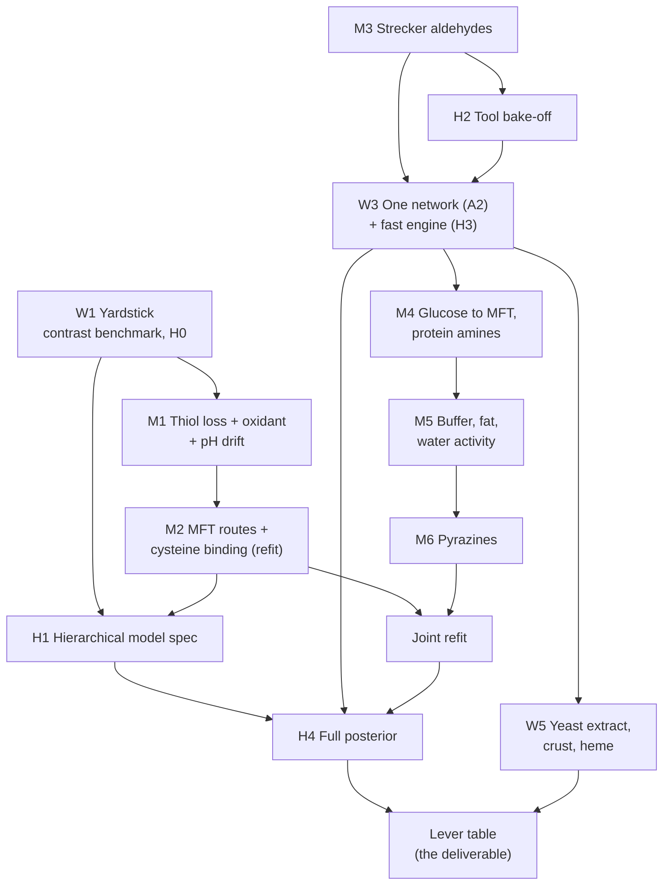

# Status and plan

*The one plan for this repository. Rewritten 2026-11-02 for readability; the content is the 2026-11-01 plan as
refined on 2026-11-02. The previous text is kept verbatim in
[docs/history/STATUS_AND_PLAN_2026-11-01.md](../history/STATUS_AND_PLAN_2026-11-01.md). Older records that cite
"STATUS_AND_PLAN sec. 5", "rule (a)", "B0", "roadmap row 2" or "triage item 3" refer to that file.*

**Contents.**
1. Who this is for and what they need
2. Where the model stands
3. Why it fails: five root problems
4. The plan at a glance
5. The workstreams
6. Timeline: what runs in parallel
7. How a change ships
8. Checkpoints and odds
9. Not in the plan
10. Glossary of codes

---

## 1. Who this is for and what they need

The users are alternative-protein scientists who formulate meaty flavour on pea, soy or similar proteins. They ask
questions like these:

- "If I add 0.5 % yeast extract, or swap ribose for glucose, does the meaty note go up or down, and by how much?"
- "What does raising the pH, adding fat, or cooking longer do to the meaty, roasted and off-notes?"
- "Which change is worth testing in the lab first?"

So the tool must:

1. **Get the direction and rough size of each lever right** for the key odorants. The odorants are the meaty thiols
   (MFT, FFT, H2S), Strecker aldehydes, pyrazines and lipid aldehydes.
2. **Accept real recipes and real cooking.** Ingredients such as protein isolate, yeast extract and oil. Cooking such
   as a pan-fried patty, not only a sealed vial of buffer.
3. **Say honestly how sure it is,** for a laboratory it has never seen.
4. **Improve on a lab's own data** (the `calibrate` verb, which exists).

Absolute levels that hold across laboratories within 3x are NOT a near-term goal. Laboratories disagree by 10x to
1000x on the same pot; no model removes that without designed data.

**Owner decisions, 2026-11-02.** Work continues without new laboratory data; the designed-experiment brief is paused.
The plan's priority is mechanisms that make the model better, not more process.

## 2. Where the model stands

Shipped calibration B60. Numbers from `results/validation/core_panel_scores.md`, `contrast_scores.md` and EX-056.

| question | today |
|---|---|
| absolute level within 3x, out of sample | 14 / 56 rows (median miss 11.8x); the "typical yield" baseline does better (15 rows, 8.1x) |
| ratio between two pots of one study | median error 0.31 dex against 0.28 for "no change"; direction right 12 / 25 |
| meaty sulfur odorants | 10 / 40 rows within 3x; thiol leave-one-lab-out NOT ADEQUATE (90 % intervals cover 0.34) |
| acrylamide, lipid aldehydes | the null model wins |
| pyrazines | about 3 orders of magnitude too low |
| Strecker aldehydes, methional, 2-acetyl-1-pyrroline | absent or refused |
| a real recipe with both sulfur and acrylamide chemistry | refused (the lanes do not combine) |

What works today: the experiment ranking (`rank`), per-lab calibration (`calibrate`), honest refusals, and an
evidence base of about 1,800 two-reader-verified fit rows, a 32-family pathway atlas and 20 ranked engine errors
([ENGINE_VS_LITERATURE.md](../reference/pathway_atlas/ENGINE_VS_LITERATURE.md)).

## 3. Why it fails: five root problems

Every task in this plan exists to fix one of these.

| # | root problem | example | fixed by |
|---|---|---|---|
| R1 | **Wrong mechanisms in the meaty sulfur chemistry** | the model destroys thiols far faster than any pot; MFT runs 99.9 % through a route labelling puts at ~7 % | workstream W2, steps M1, M2 |
| R2 | **Missing chemistry** | no Strecker aldehydes; glucose makes almost no MFT; pyrazines far too low | W2, steps M3, M4, M6 |
| R3 | **Lab pots do not transfer to food** | constants measured in phosphate buffer at fixed pH; foods are unbuffered, fatty, drier, with protein as the main amine | W2 steps M1 (pH drift), M4, M5; W5 |
| R4 | **The software cannot represent a whole recipe, and fits are slow** | four separate lanes that do not combine; one fit evaluation takes 2.5 - 21 s | W3 |
| R5 | **Uncertainty is not honest for a new laboratory** | fitted constants absorb laboratory offsets; out-of-sample coverage 0.34 | W1 (H0), W4 |

## 4. The plan at a glance

Six workstreams. W1 measures progress. W2 is the core: it fixes the chemistry. W3 and W4 give the engine and its
uncertainty. W5 turns the engine into a tool for a formulator. W6 is the owner's outside-data requests.

Read it as three lines of work that meet at the end:
- **the chemistry line** (M1 - M6, then one joint refit);
- **the engine and uncertainty line** (one network, fast engine, hierarchical posterior);
- **the product line** (ingredients, cooking, the lever table).

## 5. The workstreams

### W1. Yardstick: know whether a change helps

| task | what | state | effort |
|---|---|---|---|
| W1.1 | **Contrast benchmark scorer** on the frozen split v2: does the engine get within-study contrasts (pH, time, cysteine +/-, phosphate) right, against two null models | pre-registration v2 frozen (`results/validation/kinetic_core_contrast_benchmark_score_prereg.md`); generator to build | 17 - 21 h |
| W1.2 | **H0: between-laboratory error out of sample** from the thiol leave-one-lab-out (EX-056). Sets how wide intervals must be for a new lab | pre-registration v3 frozen (`kinetic_core_between_lab_tau_h0_prereg.md`) | 4 - 6 h + ~1 h compute |
| W1.3 | **Profile one fit evaluation** (Jacobian, pH solve, integrator) before the next long refit | not started | 2 h |

### W2. Chemistry: fix the mechanisms (the core)

Ordered by expected gain for plant-based odorants. Each step names its evidence and its decisive data; how a step ships is sec. 7. "E" numbers
refer to the ranked errors in ENGINE_VS_LITERATURE sec. 3 (and its amendments in secs. 5 and 7).

| step | mechanism | what to build | evidence | decisive data (sec. 7, item 4) | effort |
|---|---|---|---|---|---|
| **M1** | **Thiol loss and its oxidant; pH drift** (E12, CF-084) | An oxidant formed from the pot's reactive sugar intermediates (flow ~16x the thiols'); headspace O2; a reversible disulfide (Guth's release rate). The charge-balance pH on by default, with the trunk's acids. | Three removal steps failed because the decisive pots carry no oxidant ([INTRODUCTION sec. 7](INTRODUCTION.md)); weakening removal alone cuts an unseen lab's error 480x -> 18x | the 100 C reference pot over 12 h (measured: still rising; engine: peaks at 1 h); the disulfide share (measured 7 - 10 %); the Yiltirak ladder (an unseen laboratory) | 3 - 4 days |
| **M2** | **MFT routes and cysteine binding** (E6 + E11 + E10 via B59b), one refit | Per-route barriers bounded by measured classes; the cysteine-Amadori route | labelling in 3 labs (Cerny, Givaudan, Hofmann); TTCA 18 - 89 % of cysteine in 2 labs | Cerny pot D norfuraneol share (measured 0.07, engine 0.98); Givaudan ribose vs norfuraneol MFT; Hofmann 145 C fed pots; Zhai TTCA | 2 days + ~1 day on >= 8 cores |
| **M3** | **Strecker aldehydes** (E3) | Finish the forced-input layer (next step pre-registered after EX-051: one Amadori decay shared by the fed-ARP and glucose pots); then feed it from the network | DFA Garching's fed dicarbonyl series; Cremer, Balagiannis | Hofmann 2000 rows; the held-out TUM Becker contrast | 2 - 3 days |
| **M4** | **Glucose to MFT; protein as the amine** (E1, E8, plan item "amine as a variable") | On the one network (W3): a glucose + cysteine -> 1-deoxyglucosone step; amine classes (free amino acids, cysteine, protein-bound lysine); amine catalysis of enolisation | ribose / glucose MFT 10.4 measured vs 4e10 in the engine; the FFT supply pH law 10 - 70x too steep | Hofmann ribose / glucose ratios (MFT 10.4, FFT 4.3); the FFT pH slope | 1 week (after W3) |
| **M5** | **Buffer, fat, water activity** (E5, E7) | Per-step phosphate factor, linear to 0.5 M (form settled in ENGINE_VS_LITERATURE sec. 7); oil-water partition of the thiols; a water-activity term from the low-a_w kinetics on file (Eichner, Bell, Roos) | phosphate x1.3 - 12 in >= 7 labs; fat lowers thiols 3 - 143x | Potman and Kallen (E5 TEST); the unseen fat contrasts (Kim 1996, Zamora 2015, Hidalgo 1993) | 1 week |
| **M6** | **Pyrazines** (E13, E14, CF-095) | A dicarbonyl-amine adduct sink; finite aminoketone condensation with a pyrrole sink | Piloty / Sedehi consumption gap >= 1e3x; condensation declared instant today | Leahy's pH ratios; the four held-out E13 studies | 3 - 4 days |
| **JR** | **Joint refit** | One refit after M1 - M6, not one per step | -- | all of the above, together | ~1 day + compute |

**Already decided, not in the steps:** E4 (pyrazine pH law) is a declared band, no change (owner, 2026-11-01). CF-077
(methylpyrazine cross-pair factor) is merged (PR #37).

**Waiting for evidence:** E2 (enolisation split vs pH), E15 - E20. Each enters W2 when a labelling, fed-intermediate,
trapping or within-study result discriminates its rivals, for instance from a W6 author reply.

### W3. Engine: one network, built to be fast

| task | what | state | effort |
|---|---|---|---|
| A3 | One explicit configuration object instead of global switches | **done** (PRs #34, #36) | -- |
| **A2 + H3** | **One composable network** (each chemistry module adds its species, reactions, rate laws and pH terms; one integrator) **written so it compiles with exact gradients** (JAX or CasADi). The lanes become modules of one recipe. First bit-identical to today's lanes, pinned by tests; then the chemistry of M4 moves onto it | contract in [A2_MODULE_CONTRACT.md](A2_MODULE_CONTRACT.md); H3 was planned after A2, now merged into it so the engine is rewritten once | ~2.5 weeks |

Why together: A2 rewrites the lanes anyway. Writing them once in a form with exact gradients makes every later refit
~3 - 8x faster and makes the posterior (W4) affordable. Starts when M3's Strecker layer needs the shared trunk.

### W4. Uncertainty: the hierarchical Bayesian fit

This was "inference track H". It gives intervals that hold for a NEW laboratory. It does not fix a wrong structure
(P ~0.15 that it alone makes the thiol lane beat the nulls), and it can hide one inside laboratory offsets, so it
runs after the chemistry steps it depends on, with tests that catch that.

| task | what | depends on | effort |
|---|---|---|---|
| H0 | between-lab error out of sample (listed under W1.2) | -- | -- |
| **H1** | **Specify the hierarchical model,** pre-registered: laboratory offsets on observation levels and on reported conditions (heat-up lag, pH drift, buffer); on a rate constant only where >= 3 labs inform it. Masking tests: (a) lab offsets regressed on recorded pH, T, buffer, method -- a trend names a missing mechanism; (b) offsets must not change within-lab signature verdicts; (c) an offset > 0.3 dex on a physical constant is a structural error | H0, M2 | 4 - 6 h |
| **H2** | **Tool bake-off** on the Strecker layer (small, self-contained): JAX + diffrax + NumPyro vs a compiled CPU right-hand side; simulation-based calibration; a deliberately wrong structure must be caught; GPU benchmarked here before any Colab run | M3 | 8 - 12 h |
| H3 | the fast engine: merged into W3 (A2 + H3) | -- | -- |
| **H4** | **Full posterior** on each lane that passes its structure tests; compared with the cheap alternative (Laplace + H0's offset) by held-out log density | W3, H1, JR | 1 - 2 days + 6 - 24 h per run |

Rules kept from track H: a separate `maillard-jax` environment (the core lock unchanged); Colab returns posterior draws
only, and every artifact is made locally from them; nothing private goes to Colab.

### W5. The tool for formulators: recipes, cooking, and the deliverable

Standalone modules to the A2 contract. They move no shipped constant. Each says in its output that it is not
validated on a plant-based product.

| task | what | sources | effort |
|---|---|---|---|
| W5.1 | **Ingredients to precursors.** Yeast extract to cysteine, glutathione, IMP -> ribose (nucleotide breakdown kinetics) and thiamine; protein isolates to their amine and cysteine content. Removes the scorer's "precursor unmapped" refusals | 14 yeast-extract papers selected 2026-11-02 (composition: Münch 1997, Kuroda 1997, Jacob 2019, Tomé 2021; nucleotide kinetics: Matoba 1988, Shaoul 1987, Davídek 1972, Kuchiba 1990, Kavitha 2007; routes: Peer 1968, Madruga 1998, Alim 2019 labelling; checks: Münch 1998, Alim 2018) | 2 - 3 days |
| W5.2 | **Crust.** A heat and moisture history for a pan-fried or grilled patty, feeding the existing thermal-history and water-activity terms | 8 crust papers selected 2026-11-02 (Parker 2012, Balagiannis 2019, Chan 2020, Purlis 2009, Bassama 2011, Sprague 2011, Oroszvári 2005, Kondjoyan 2016). No plant-based patty profile exists; it is checked on meat and potato data | 3 - 5 days |
| W5.3 | **Heme and iron catalysis** of thiol and lipid oxidation (leghemoglobin products). Builds on M1's oxidation chemistry | Impossible Foods patents already on file | after M1 |
| **W5.4** | **The lever table: the deliverable.** Per odorant and per lever (cysteine or yeast extract, sugar type, thiamine, pH, fat, temperature and time, cooking method): direction, size with interval, and whether the held-out benchmark supports it | JR, H4 (Laplace intervals as the fallback) | 2 - 3 days |

### W6. Outside data, without a laboratory (owner)

- Send the 5 drafted author data requests (`data/articles/OUTREACH_DRAFTS.md`, laptop only).
- Add requests for existing data that would test a W2 step (ENGINE_VS_LITERATURE sec. 3.1, the "Or" alternatives):
  Cerny's raw 145 C isotopologue data (M2); DFA's raw Table 4 and Quest's recovery (M3, CF-073); Zhou 2024's
  supplementary ion data (M6); the BTBU / CAAS MFT yields per glucose consumed (M4).
- Literature keying only where a W2 step's test lacks held-out rows (E3, E10, E18 are one laboratory short).

## 6. Timeline: what runs in parallel

Each row is a week. Columns are workstreams. Cells in one row run in parallel.

| week | W1 yardstick | W2 chemistry | W3 engine | W4 uncertainty | W5 product | W6 owner |
|---|---|---|---|---|---|---|
| 11-02 - 11-08 | benchmark scorer; H0; profile | M1 written down | -- | -- | -- | send requests |
| 11-09 - 11-15 | -- | M1 built and tested; M2 refit | -- | H1 spec (after M2) | -- | -- |
| 11-16 - 11-22 | -- | M3 Strecker | design | H2 bake-off on M3 | W5.1 yeast extract (standalone) | -- |
| 11-23 - 12-06 | -- | M4 on the new network | A2 + H3 | -- | W5.2 crust (standalone) | -- |
| 12-07 - 12-13 | -- | M5 | -- | -- | W5.1 / 5.2 joined to the network | -- |
| 12-14 - 12-20 | -- | M6; joint refit | -- | H4 posterior (sulfur lane) | W5.3 heme | -- |
| 12-21 - 01-10 | benchmark re-scored | -- | -- | H4 other lanes | W5.4 lever table | -- |

Hard dependencies: M1 before M2's refit (same rows); M3 before H2 and W3; W3 before M4 and H4; M2 and H0 before H1;
the joint refit before H4; H4 (or its fallback) before the lever table.

## 7. How a change ships

**Principle.** A change ships when the evidence favours it over the current model and over the other explanations,
judged on the data that measure that mechanism most directly. The rule is written so that the decision does not
depend on who makes it or on what they hope to find. It replaces the 2026-11-01 admission gate (>= 2 held-out
laboratories before any work) and the owner-approval step.

**The case.** One page in the PR. Items 1 - 5 are written BEFORE any result of the change is computed.

1. **The claim.** Which mechanism, and which steps of the network change.
2. **All the evidence, by kind.** The kinds rank by how directly they show a mechanism, and the rank is fixed:
   isotope labelling; fed intermediates; trapping; measured intermediates and lifetimes; mass balance; one factor varied
   inside one study; fitted time courses. The case lists every source on disk that bears on the claim, including those
   against it. A source left out needs a stated reason.
3. **The rivals.** The current model, the proposed change, and at least one other explanation of the same evidence.
4. **The decisive data.** The measurements on which the rivals predict different things, chosen from those closest to
   the mechanism: route shares from labelling, branching ratios, ratios that cancel scale, the sign of a within-study
   contrast. End-point levels that other errors also move are not decisive. If the rivals predict the same thing on
   every available measurement, the data cannot decide, and the case says so.
5. **Tolerances from the data.** Each comparison uses the measurement's own reported noise; across laboratories, the
   between-laboratory spread (H0). No round-number thresholds.

Then:

6. **The comparison.** Every rival is scored the same way, on the same data, under the same measurement model.
   Constants come from measurements or same-class analogues where they exist. Only converged fits count. The result
   is a comparison between rivals (likelihood on the decisive data), not a pass mark.
7. **The side effects.** The full held-out benchmark, before and after, every row. A row that gets worse is expected
   when the old model relied on a compensating error. The case names the suspected compensating error and registers it
   (a CF entry). A loss does not block shipping. A large loss with no candidate explanation is a reason to look
   further before shipping.
8. **The adversarial review.** An independent reviewer whose task is to build the strongest case AGAINST the change.
   The reviewer sees the evidence and the data, not the author's conclusion. Every objection is answered in the record,
   or the change waits.
9. **The decision.** The change ships if the decisive data favour it over every rival and no objection is left
   unanswered. The decision and its basis go into the experiment register (an EX entry). A shipped change is reversed
   when later evidence favours another rival.

**Why this resists persuading ourselves.** The ranking of evidence is fixed in advance. The rivals and the decisive
data are named before results exist. Tolerances come from the measurements. The decision is a comparison, not a
threshold someone picked. Evidence against must be listed. The reviewer's job is to disagree.

The working session applies this rule and ships. The owner sees a summary of what shipped and why.

Working rules that stay: run through `./scripts/docker_maillard.sh run`; nothing writes into `data/` at runtime; one
writer per shared file (registers, ledger, atlas); stage files by explicit path; check new CF / EX ids against
`origin/main` and open branches; a "held-out" claim is checked against the split files. The full list of lessons is
`tasks/lessons.md`.

## 8. Checkpoints and odds

| date | done means | P |
|---|---|---|
| 11-07 | benchmark scored; H0 scored; profile done | ~0.6 |
| 11-15 | M1 and M2 have verdicts | ~0.5 |
| 11-22 | M3 has a verdict; H1 and H2 done | ~0.45 |
| 12-06 | the one network runs bit-identical with exact gradients; M4 has a verdict | ~0.35 |
| 12-20 | M5, M6 and the joint refit done; a posterior on the sulfur lane | ~0.25 |
| 01-10 | the first lever table, scored on the held-out benchmark | ~0.3 |

Other odds: M1 noticeably improves the sulfur lane out of sample, ~0.5. The sulfur lane beats both null models after
M1 + M2, ~0.4. Ranked relative predictions with honest intervals for most levers by mid-January, ~0.35. Absolute levels
within 3x across laboratories for most rows, ~0.15 (not a goal).

## 9. Not in the plan

- New laboratory experiments and the designed-experiment brief (paused by the owner).
- Broad literature searches and the consolidation wave V. Reading is limited to the papers named above and W6.
- New engine switches without a case (sec. 7).
- The E6 + E11 refit queue on its own branch as a separate exercise: it becomes M2.

## 10. Glossary of codes

| code | meaning | where |
|---|---|---|
| W1 - W6 | the workstreams of this plan | sec. 5 |
| M1 - M6, JR | the chemistry steps and the joint refit | sec. 5, W2 |
| E1 - E20 | ranked engine mechanism errors | [ENGINE_VS_LITERATURE.md](../reference/pathway_atlas/ENGINE_VS_LITERATURE.md) sec. 3, amended in secs. 5 and 7 |
| CF-nnn | a registered conflict between sources or between data and model | `docs/reference/conflicts_register.yml` |
| EX-nnn | a registered experiment (fit, test, review) and its verdict | `docs/reference/experiment_register.yml` |
| A2 | the one composable network (W3) | [A2_MODULE_CONTRACT.md](A2_MODULE_CONTRACT.md) |
| A3 | the explicit engine configuration (done) | `src/kinetic_core/config.py` |
| H0 - H4 | the uncertainty stages (W1.2, W4); H3 is merged into A2 | sec. 5 |
| B-numbers (B1 - B64) | earlier fit waves of the shipped calibration (B60 is shipped) | `results/validation/kinetic_core_b*` |
| TEST / DEVELOPMENT | the frozen split of held-out vs development evidence | `docs/reference/contrast_benchmark/` |
| lane | one of the four separate networks today (trunk, sulfur, acrylamide, lipid) | README |
| MFT, FFT | 2-methyl-3-furanthiol, 2-furfurylthiol: the key meaty odorants | [GLOSSARY.md](GLOSSARY.md) |
| norfuraneol (NF), TTCA, DPO, 1-DG | intermediates: a furanone, the cysteine-sugar ring compound, 1-deoxypentosone, 1-deoxyglucosone | [GLOSSARY.md](GLOSSARY.md) |
| dex | a factor of 10 on a log scale (0.3 dex ~ 2x) | -- |
